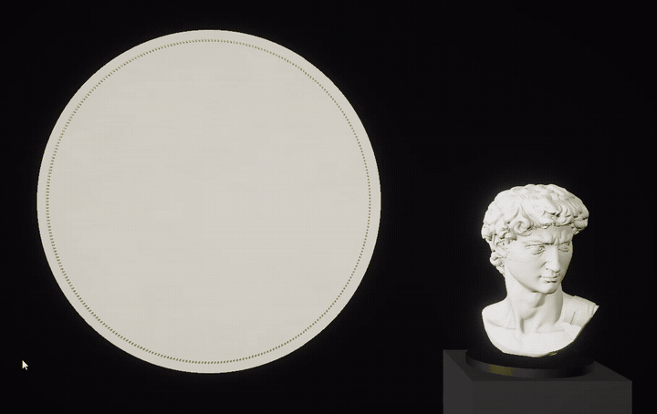

# Threadline

Real-time string art in Unity 6. A GPU solver strings several thousand straight threads between 320 nails so that together they match a camera image of a plaster bust, and it keeps re-solving the portrait while the bust turns.



A plaster bust stands on a turntable on the right. A second camera, `SubjectCam`, renders it on white, and on the round board to the left 320 brass nails hold several thousand straight threads whose combined darkness matches that image. Turn the bust with the Model Rotation slider or pick another one with Figure, and threads wind off and on until the portrait fits again. Everything runs in Play mode inside the editor, and every parameter is an Inspector slider. I recorded the demo in the editor on a laptop with an AMD Ryzen 7 5700U and its integrated Radeon graphics; it has no discrete GPU.

## How it works

The usual string-art algorithm is a greedy loop: start at a nail, pick the chord to the next nail that covers the most remaining darkness, subtract it from the image, repeat until the thread budget runs out. It runs once per picture. Threadline keeps a set of active chords in a texture and improves it a few steps every frame. The state carries over between frames, so when the image changes, the search continues from the threads already on the board and only the ones that no longer fit move.

All solver passes are draws into render textures, recorded into one command buffer per frame (`StringArt.Tick`): a full-screen triangle for target, score, select and visibility, and one mesh draw for coverage. There are no compute shaders.

### Target image

`SubjectCam` sees only the `Subject` layer and renders the bust on white into a 512×512 texture. `ThreadTarget.shader` turns that into the target darkness $`T`$: 1 where threads need to be dense, 0 on white and outside the circle of nails.

```math
L' = L + s\,(L - \bar{L}_r), \qquad
d = \operatorname{sat}\big((1 - L' - b)\,c\big)^{\gamma}, \qquad
T = \operatorname{sat}\big(d + e\,\lVert \nabla L \rVert\big)
```

$`L`$ is the Rec. 709 luma of the camera colour raised to 1/2.2: the project renders in linear space, and the threads should match perceived brightness. $`\bar{L}_r`$ averages 8 taps on a ring of radius $`r`$ texels (Sharpen Radius), which makes $`L'`$ an unsharp mask with strength $`s`$ (Sharpen). Facial features are smaller than the nail spacing and get lost without it. $`b`$, $`c`$ and $`\gamma`$ are Black Point, Contrast and Gamma. The gradient comes from central differences and is added with weight $`e`$ (Edge Boost), because threads read best along edges.

### Line space

Nail $`k`$ of $`n`$ sits at

```math
p_k = \left(\tfrac12, \tfrac12\right) + \tfrac12\,(\cos\theta_k,\ \sin\theta_k), \qquad \theta_k = \frac{2\pi k}{n}
```

in target UV. Every possible thread is one texel of an $`n \times n`$ float texture: texel $`(a, b)`$ with $`a < b`$ is the chord from nail $`a`$ to nail $`b`$. The lower triangle stays empty, and chords between nails closer than Min Gap along the circle are skipped. At 320 nails and Min Gap 16 that leaves 46,240 candidate chords. Score, state and visibility all use this layout, so one full-screen pass handles every chord in parallel.

### Score

`ThreadScore.shader` takes the mean residual along each chord from 96 bilinear samples:

```math
m(a,b) = \frac{1}{96}\sum_{j=0}^{95}\big(T - C\big)\!\left(p_a + \frac{j + 0.5}{96}\,(p_b - p_a)\right)
```

$`C`$ is the coverage of the threads that are currently on (see below). This is a discrete Radon transform of the residual. A positive $`m`$ means the chord crosses darkness that is still missing; a negative one means that stretch already has too much thread.

### Select

The solver minimises $`E = \sum (T - C)^2`$. A thread adds $`\alpha`$ (Line Darkness) to the coverage under it. Treating the samples as the pixels the chord covers, switching a chord on changes the error by

```math
\Delta E_{\text{on}} = \sum_j \big[(r_j - \alpha)^2 - r_j^2\big] = N\alpha\,(\alpha - 2m),
```

which is negative when $`m > \alpha/2`$. Taking an active thread off gives $`N\alpha(\alpha + 2m)`$, negative when $`m < -\alpha/2`$. `ThreadSelect.shader` applies this to every chord at once and writes the new state into a second texture (the two are swapped each iteration):

```math
s' =
\begin{cases}
1 & \text{if } s = 0,\ m > \tfrac{\alpha}{2} + h + \beta,\ \xi < p_{\text{add}} \\
0 & \text{if } s = 1,\ m < -\tfrac{\alpha}{2} - h,\ \xi < p_{\text{remove}} \\
s & \text{otherwise}
\end{cases}
```

$`h`$ is Hysteresis and stops threads from flickering at the threshold. $`\beta`$ (Add Threshold Boost) raises the bar for new threads only: start it high, bring it down to zero, and the portrait grows out of its darkest areas. $`\xi`$ is a hash of $`(a, b, \text{seed})`$ with a new seed every iteration. The random test is there because every chord is judged against the same residual: without it, a bundle of nearly identical chords through one dark patch would switch on together, overshoot, and all switch off on the next step. With Add Probability at 0.08, about 8% of the qualifying chords go in per iteration, the coverage updates, and the rest look again. Remove Probability does the same for removals.

### Coverage and persistent state

`ThreadCoverage.shader` draws every active chord into a 512×512 float coverage texture with additive blending. It is one mesh with a quad per candidate chord. Quads of inactive chords collapse to a point in the vertex shader; active ones are Coverage Width texels wide and write $`\alpha`$. So $`C(x)`$ is $`\alpha`$ times the number of threads over $`x`$.

Coverage, score and select repeat Iterations Per Frame times every frame (4 by default). Nothing clears the chord state except Reset Threads or a change of Nails or Min Gap, which rebuilds the board. That makes it a continuous local least-squares search: a slight turn of the bust shifts the residual a little, and only the chords whose score crosses a threshold flip.

### Rendering

The visible threads lag behind the solver so they can animate. `ThreadVis.shader` moves a visibility value $`v`$ per chord toward its state by dt / Wind Time each frame, clamped to [0, 1]. `ThreadChords.shader` draws the thread from nail $`a`$ to $`\operatorname{lerp}(p_a, p_b, \operatorname{smoothstep}(v))`$, so a new thread winds on from one nail to the other and a removed one winds back.

The threads reuse the coverage mesh: four vertices per chord, all at the origin, with the nail pair in UV0 and (end, side) in UV1. The vertex shader places everything:

- A hash of $`(a, b)`$ lifts each thread 1 to 6 mm above the board, so threads cross at different heights and the board has some depth when the camera moves around it.
- The thread is a ribbon facing the camera; its side vector is the cross product of the thread direction and the view direction.
- Width is $`w = \max\!\big(w_{\text{phys}},\ k_{\text{px}} \cdot \tfrac{2z}{P_{11} H}\big)`$: the physical Thread Width, or Thread Min Pixels times the world size of a pixel at the thread's view depth $`z`$, whichever is larger ($`P_{11}`$ is the vertical scale of the projection matrix, $`H`$ the screen height in pixels). Alpha is $`\min(0.9,\ \text{ink}/w) \cdot \text{opacity}`$. Below the 0.9 cap, alpha times width stays constant, so the portrait keeps its tone from far away and a close-up shows a thin dense thread. The pixel minimum keeps distant threads from breaking up into stair steps and moiré.
- The fragment shader uses a round profile $`1 - \text{side}^2`$ with a narrow sheen in the middle and multiplies into the frame (`Blend DstColor Zero`), so crossings get darker the way real thread does.

The shadows are the same mesh with a second material that has Shadow Mode on, drawn just before the threads. Each thread is laid flat 0.4 mm above the board and shifted by (0.46, -0.51) times its lift, which lines up with the Board Light coming from the upper left. A shadow is three times wider than its thread with alpha scaled by 0.35 / 3, and higher threads throw theirs farther.

Visible Threads in the Inspector comes from an async GPU readback of the state texture twice a second.

Each chord is independent, so the result has no winding order. You could not use it as a plan for a physical piece strung with one continuous thread.

### Sound

`ThreadAudio.cs` listens to the solver itself. Every frame it reads the state texture back with `AsyncGPUReadback` and compares it with the previous frame, so it knows exactly which chords went on and which went off. A chord that switched on plays a pull (thread drawn through cloth or a taut nylon line) and, after about Wind Time, a short tick when the thread reaches the far nail. A chord that switched off plays a softer release. Pitch follows the chord length (long threads sound lower) and pan follows where the chord lies on the board.

Thousands of chords can flip in one frame when the portrait rebuilds, so the sound is budgeted: at most Max Per Second one-shots start each second, picked by reservoir sampling from that frame's events, and above Burst Threshold changes per frame the long pulls mostly give way to ticks. Under that, a loop of many overlapping thread grains swells with the number of changes per second.

The clips are slices of CC0 recordings of real thread, see `Assets/Threadline/Audio/CREDITS.txt`.

## Inspector

Select the `StringArt` object in the Hierarchy. It has three components: Figure Switcher, String Art and Thread Audio. The defaults below are the values in the code and in the scene. With them, Visible Threads sits around 6 to 8 thousand.

Figure Switcher

| Parameter | Range | Default | What it does |
|---|---|---|---|
| Figure | 0 to 3 | 0 | Which bust is shown: 0 David, 1 Homer, 2 Dying Alexander, 3 Horse of Selene |
| Model Rotation | -90 to 90 | 0 | Turntable angle in degrees |

String Art

| Parameter | Range | Default | What it does |
|---|---|---|---|
| Visible Threads | counter | | Threads currently on |
| Nails | 64 to 512 | 320 | Nails on the circle. Changing it rebuilds the board and the portrait starts over |
| Line Darkness | 0.01 to 0.12 | 0.025 | $`\alpha`$, the darkness one thread takes off the residual. Lower means more threads |
| Thread Opacity | 0 to 3 | 1 | Multiplier on the drawn thread density |
| Thread Width | 0.0001 to 0.003 | 0.00035 | Physical width in metres |
| Thread Min Pixels | 0.5 to 4 | 1.5 | Minimum width on screen; thinner gives stair steps and moiré |
| Thread Ink | 0.00002 to 0.0004 | 0.00016 | Ink per unit length; sets the tone of the portrait from a distance |
| Thread Sheen | 0 to 1 | 0.3 | Highlight along the middle of the thread |
| Wind Time | 0.05 to 2 | 0.35 | Seconds to wind one thread on or off |
| Thread Shadows | on/off | on | Shadow pass on the board |
| Contrast | 0.5 to 2.5 | 1.15 | $`c`$ in the target. Too much turns the bust into a solid silhouette |
| Sharpen | 0 to 4 | 1.5 | Unsharp mask strength $`s`$ |
| Sharpen Radius | 1 to 8 | 4 | Unsharp mask radius in target texels |
| Edge Boost | 0 to 2 | 0.6 | Weight $`e`$ of the gradient term |
| Black Point | 0 to 0.5 | 0.05 | $`b`$; anything brighter than $`1 - b`$ counts as white |
| Gamma | 0.5 to 2 | 1 | $`\gamma`$ applied to the darkness |
| Flip Y | on/off | off | Flips the target vertically |
| Iterations Per Frame | 1 to 8 | 4 | Coverage, score and select rounds per frame |
| Min Gap | 4 to 40 | 16 | Chords between nails closer than this are not used. Changing it rebuilds the board |
| Hysteresis | 0 to 0.05 | 0.006 | $`h`$, margin that keeps threads from flickering at the threshold |
| Add Probability | 0.001 to 1 | 0.08 | Chance that a qualifying chord switches on in one iteration |
| Add Threshold Boost | 0 to 0.6 | 0 | $`\beta`$, extra threshold for new threads only |
| Remove Probability | 0.01 to 1 | 0.12 | Chance that a chord marked for removal switches off in one iteration |
| Coverage Width | | 1 | Thread width in target texels when coverage is drawn |
| Target Size | | 512 | Resolution of the target and coverage textures, read when the component is enabled |
| Radius | | 0.5 | Radius of the nail circle in metres |

Thread Audio

| Parameter | Range | Default | What it does |
|---|---|---|---|
| Pull, Nail, Release Clips | | Audio/ | One-shots picked at random per event |
| Rustle Loop | | rustle_loop | Loop under mass changes |
| Volume | 0 to 1 | 1 | Master volume |
| Pull, Nail, Release, Rustle Volume | 0 to 1 | 0.7, 0.55, 0.3, 0.2 | Per layer volume |
| Rustle Rate | 50 to 5000 | 800 | Changes per second at which the rustle reaches about two thirds of its volume |
| Max Per Second | 4 to 120 | 36 | One-shot budget |
| Voices | 4 to 64 | 24 | Audio sources in the pool |
| Burst Threshold | 1 to 200 | 24 | Changes per frame above which pulls mostly give way to ticks |
| Pitch Range | | 0.85, 1.25 | Pitch of the longest and of the shortest chord |
| Pitch Jitter | 0 to 0.1 | 0.04 | Random pitch spread |
| Stereo Width | 0 to 1 | 0.6 | How far pan follows the chord position |
| Added / Removed Per Second | counter | | Threads pulled on and taken off during the last second |

## Running it

Unity 6000.3.23f1 or a newer 6000.3 release, URP 17.3.

1. Clone the repository and add the folder in Unity Hub. The four scans are OBJ files of about 20 MB each, so the initial import takes a while.
2. Open `Assets/Threadline/Threadline.unity` and press Play. The board starts empty and David's portrait winds itself on.
3. Select `StringArt` in the Hierarchy. Drag Figure to switch busts and Model Rotation to turn the turntable. To watch a portrait build from an empty board again, click into the Game view and press R. The same is in the String Art component menu (the ⋮ button or a right click on its header): Rebuild Slowly brings the threads back gradually, darkest areas first, and Reset Threads just clears the board.

Threadline > Build Scene rebuilds the scene from code (materials, lights, both cameras, the post-processing volume, the four busts on the turntable, the thread sound) and saves it over `Threadline.unity`. Threadline > Setup Audio adds Thread Audio to the open scene and fills in its clips from `Audio/`. It also adds a `Subject` layer and sets MSAA to 4x on the URP assets. Threadline > Capture Frames renders the solved portrait at three turntable angles, with the target and coverage textures, into `Captures/`. After that it renders a 10-second take (the portrait builds from an empty board, then the bust turns while the camera orbits) as 300 JPG frames in `Captures/Sequence/`. The same build and capture also run without the editor window:

```
Unity.exe -batchmode -projectPath <path> -executeMethod ThreadlineSetup.BatchAll
```

`ThreadlineFilm.Render916` and `ThreadlineFilm.Render45` (run them with `-batchmode -quit -executeMethod`) render a 12-second camera move frame by frame at 9:16 and 4:5 with depth of field, into `Captures/Film/` and `Captures/Film_45/`. Next to the frames they write `events.txt` with the number of threads added and removed in every frame, plus the length and horizontal position of up to 40 new ones, for syncing sound to the board.

## Project layout

```
Assets/Threadline/
  Threadline.unity          the scene
  StringArt.cs              Inspector parameters, board and chord mesh, per-frame solver command buffer
  FigureSwitcher.cs         Figure and Model Rotation
  ThreadAudio.cs            thread sound driven by the chords that switch on and off
  Spin.cs                   constant rotation, kept at zero on the turntable
  ThreadlineDemo.cs         optional tour that animates the parameters (Auto Play), not used in the scene
  Shaders/
    ThreadTarget.shader     camera image to target darkness
    ThreadScore.shader      mean residual per chord in line space
    ThreadSelect.shader     on/off decision per chord
    ThreadCoverage.shader   active chords into the coverage texture
    ThreadVis.shader        winding on and off
    ThreadChords.shader     thread ribbons and their shadows
  Editor/
    ThreadlineSetup.cs      Threadline menu (Build Scene, Setup Audio, Capture Frames) and the batch entry point
    ThreadlineFilm.cs       offline frame-by-frame render of a camera move
  Audio/                    thread one-shots and the rustle loop, with CREDITS.txt
  Models/                   the four SMK scans as OBJ
  Materials/ Textures/ Settings/   written by Build Scene
docs/                       demo image
```

## Credits

The busts are 3D scans of plaster casts from SMK, Statens Museum for Kunst (Copenhagen), released into the public domain on [open.smk.dk](https://open.smk.dk):

- Head of Michelangelo's David, KAS2232
- Homer, KAS210
- Dying Alexander, KAS282
- Horse of Selene, KAS2120

I converted them from STL to OBJ for import.

Background on computational string art: Petros Vrellis, "A new way to knit" (2016), and Birsak, Rist, Wonka, Musialski, "String Art: Towards Computational Fabrication of String Images", Eurographics 2018.

The thread sounds are cut from CC0 recordings on freesound.org: "Sewing cloth" by heifabaisi, "nylon rope string fishing line handling" by kyles, "dental floss sounds" by digital.arts.MA and "nylon string pull" by alec_mackay. Links are in `Assets/Threadline/Audio/CREDITS.txt`.

## License

The code is under the [MIT license](LICENSE). The scans in `Assets/Threadline/Models/` are public domain, from SMK. The sounds in `Assets/Threadline/Audio/` are CC0.

Made by Aleksandr Kartak, Unity developer and technical artist ([matbcontrol.github.io](https://matbcontrol.github.io)). I take freelance work on rendering, shaders and tools.
